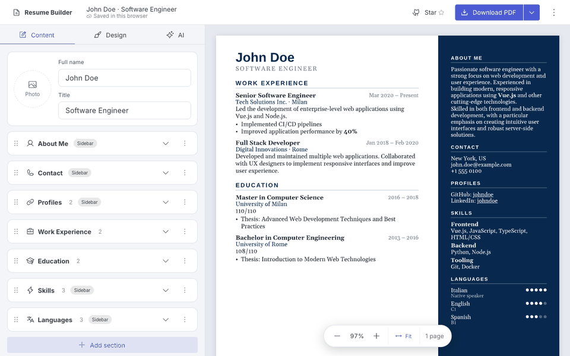
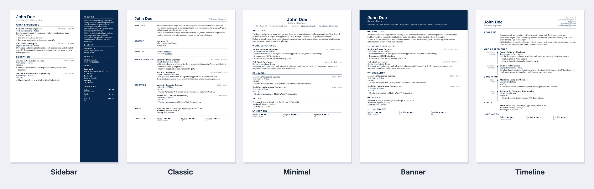
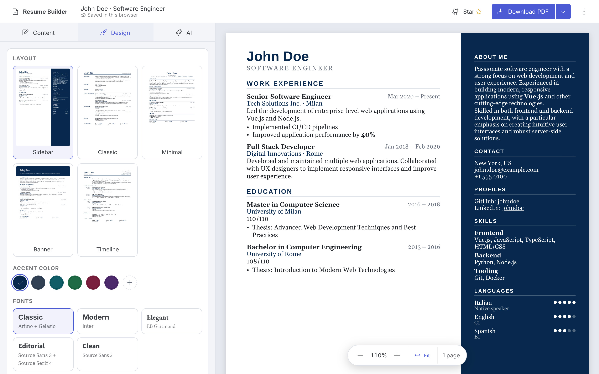

# Resume Builder

**A free, private resume builder that typesets real PDFs in your browser.** No account, no paywall on the download, and your data never leaves your device.

[](https://resume-builder.gianfrancodemarco.dev/)

[](https://github.com/gianfrancodemarco/resume-builder/stargazers)
[](https://github.com/gianfrancodemarco/resume-builder/actions/workflows/test.yml)
[](LICENSE)
[](https://jsonresume.org/schema)
[](https://typst.app)



## Why this one?

Most online resume builders let you write for free and then charge for the PDF, or keep your data on their servers. This one doesn't:

- **Private by design**: everything runs and is saved in your browser. There is no backend and no account.
- **Real typesetting**: resumes are compiled with [Typst](https://typst.app) running as WebAssembly, so the PDF has proper typography and embedded fonts, and looks the same on every device.
- **No lock-in**: your resume is a standard [JSON Resume](https://jsonresume.org/schema) file. Import one from any JSON Resume tool, or export yours and take it elsewhere.
- **Free and open source**: MIT licensed. Use the hosted version or self-host it with Docker.

## Layouts

Five layouts, each with any accent color and font pairing:



## Features

- 🎨 **Five layouts**: Sidebar, Classic, Minimal (ATS friendly), Banner and Timeline
- 🖌️ **Simple design choices**: an accent color (every other color is derived from it so text stays readable), five font pairings, text size and density
- 📝 **Live preview**: the real pages update as you type, with zoom, fit-to-width and a page count
- 🔄 **Flexible sections**: add, remove, reorder and hide any JSON Resume section, and place it in the main column or the sidebar
- ✋ **Drag and drop**: reorder sections and entries, and edit entries inline
- 💾 **Export**: PDF, JSON Resume or plain text (for pasting into application forms)
- 🤖 **AI import**: turn an existing CV file into an editable resume with a model of your choice via [OpenRouter](https://openrouter.ai), using your own API key
- 📱 **Works on mobile**: usable on desktop and phones
- 📚 **CV writing guide**: built-in tips on writing a good resume



## Support the project

If this saved you from a paywalled resume site, a ⭐ on GitHub helps other people find it. Bug reports, ideas and pull requests are welcome too: see [CONTRIBUTING.md](CONTRIBUTING.md) and the [open issues](https://github.com/gianfrancodemarco/resume-builder/issues).

## Getting Started

### How it works

The resume is a [JSON Resume](https://jsonresume.org/schema) document; `src/resume/` holds the section definitions (which drive the editor forms, the renderer and the AI output schema) and the app settings stored under `meta.resumeBuilder`. Text fields use Markdown.

Templates live in `src/typst/templates` as Typst files. `src/typst/document.js` turns the resume into JSON that the templates read, and `src/typst/TypstService.js` runs the compiler in the browser to produce the SVG preview and the PDF. Fonts are bundled as TTF files in `public/fonts` (Typst cannot use system fonts in the browser); to change the set, edit `src/typst/fonts.js` and run `node scripts/fetch-fonts.mjs`.

### Prerequisites

- Node.js (v20 or higher) and npm/yarn, OR
- Docker and Docker Compose (v2.22.0 or later)

### Installation

#### Option 1: Local Development

1. Clone the repository:
   ```bash
   git clone https://github.com/gianfrancodemarco/resume-builder.git
   cd resume-builder
   ```

2. Install dependencies:
   ```bash
   npm install
   # or
   yarn install
   ```

3. Start the development server:
   ```bash
   npm run dev
   # or
   yarn dev
   ```

4. Open your browser and navigate to `http://localhost:5173`

#### Option 2: Docker Development (Recommended)

1. Clone the repository:
   ```bash
   git clone https://github.com/gianfrancodemarco/resume-builder.git
   cd resume-builder
   ```

2. Start with Docker Compose Watch:
   ```bash
   docker compose up --build --watch
   ```

3. Open your browser and navigate to `http://localhost:5173`

## Technologies Used

- [Vue 3](https://vuejs.org/) - Progressive JavaScript framework
- [Vuetify 3](https://vuetifyjs.com/) - Material Design component framework
- [TipTap](https://tiptap.dev/) - Rich text editor
- [Phosphor Icons](https://phosphoricons.com/) - Icon library
- [Docker](https://www.docker.com/) - Containerization platform
- [Docker Compose](https://docs.docker.com/compose/) - File watching and hot reload

## Disclaimer

This project is a work in progress, provided "as is" without warranties. Much of the code was written with AI assistance. Please [report any bugs](https://github.com/gianfrancodemarco/resume-builder/issues) you find.

## License

This project is licensed under the MIT License - see the [LICENSE](LICENSE) file for details.

## Acknowledgments

- Icons by [Phosphor Icons](https://phosphoricons.com/)
- CV Writing Guide by [Guido Penta](https://github.com/GuidoPenta/galactic-CV-guide-for-developers)
- Inspiration from modern resume templates
